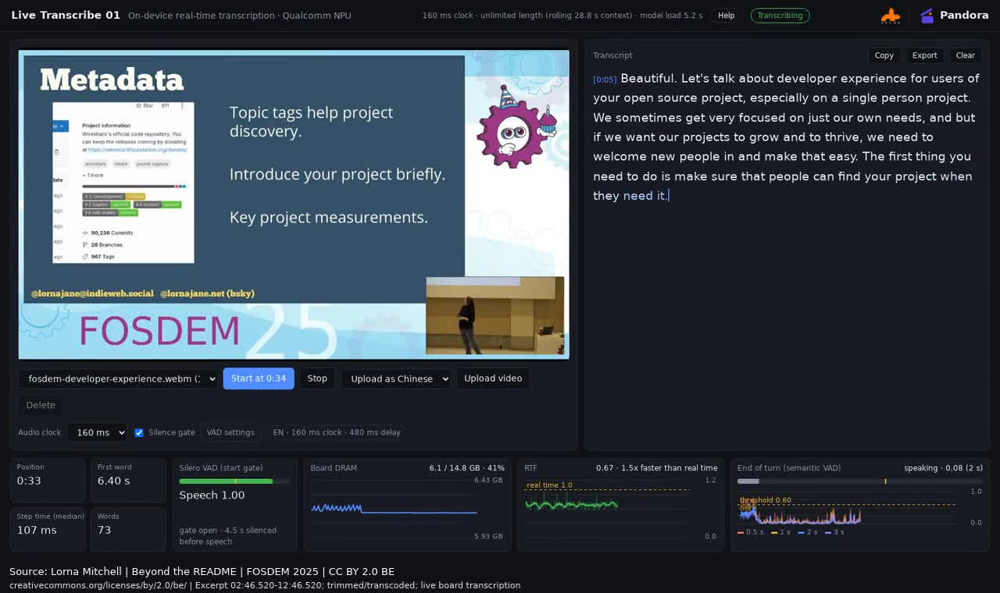

# Audio8-ASR-Infinite Demo · Agora

Streaming speech recognition on Qualcomm devices, powered by Edge0's [Audio8-ASR-Infinite](https://huggingface.co/Edge0/Audio8-ASR-Infinite). Includes a Web Demo, Python examples and C++ integration example.

[Pandora](https://pandora.aidlux.com/en/demos/live-transcribe-01/) · [ModelFarm](https://aiot.aidlux.com/en/models?name=Audio8)

[](https://pandora.aidlux.com/demos/live-transcribe-01/demo.mp4?v=14dc73371549)

[Watch video](https://pandora.aidlux.com/demos/live-transcribe-01/demo.mp4?v=14dc73371549) · [Download recording](docs/demo.mp4)

Source: Lorna Mitchell, FOSDEM 2025, **CC BY 2.0 BE**. Original credits are retained; the excerpt is trimmed and transcoded. [Source, license and changes](docs/MEDIA_ATTRIBUTION.md).

SDK version 0.9.0 supports the configurable models.json version 2 package.

## Agora deployment

Use standard Git, Python venv, Git LFS, and project commands. No Agora CLI is required.

**The global configuration contains common deployment information only:** workspace, content ID, code/resource repositories and versions, SoC, and operating system. Copy the [configuration template](agora/agora.env.example) and edit it yourself, or download the same format prefilled by Agora from your content/hardware selections. Save it on the device and source it once in Bash.

Follow the [deployment guide](docs/AGORA_DEPLOY.md). Agora displays the corresponding steps in Chinese; this repository and the HF model cards are in English.

The Audio8 clock is read from the selected package's models.json. The web port is a normal application launch option. Neither belongs in the global configuration. The project maintains its SoC/resource filters in [agora/resources.env](agora/resources.env); developers do not maintain model filenames in their global configuration.

Every workspace uses the same directory convention:

```text
$AGORA_WORKSPACE/
├── code/                 # Git checkout and its .venv
├── resources/            # Selected HF package root
└── check-environment.py
```

Use a separate workspace for a different content/hardware combination to avoid mixing checkouts or model targets. Existing checkout updates remain your responsibility. Source the saved global configuration again in a new terminal.

## Supported platforms

SDK 0.9.0 supports CPython 3.10 / 3.11 / 3.12. The qualified combination is QCS8550 / Ubuntu 22.04 / AidLite 2.5.0.284 / QNN 2.48, with both 80ms and 160ms packages. QCS8625, IQ8/QCS8275, and IQ9/QCS9075 resource files are available, but their presence does not qualify the entire SDK/BSP/runtime stack. Other SoCs and Ubuntu 24.04/26.04 require separate on-device validation.

Model repositories:

- [160ms resources](https://huggingface.co/APLUX-Agora/Audio8-ASR-Infinite-160ms)
- [80ms resources](https://huggingface.co/APLUX-Agora/Audio8-ASR-Infinite-80ms)

These repositories are public. If you use a private fork or restricted model later, authenticate through the service's standard tools and keep credentials out of configuration files. See [model resource setup](docs/MODEL_SETUP.md).

## API reference

- [Python SDK API](sdk/PYTHON_API.md)
- [C ABI integration and C++ build instructions](sdk/NATIVE_INTEGRATION.md)
- [SDK requirements and compatibility](sdk/README.md)

## License

See [LICENSING.md](LICENSING.md) for component scopes, [LICENSE](LICENSE) for the license index,
and [NOTICE](NOTICE) for attribution. Demo/example code and public interfaces use Apache-2.0;
the precompiled SDK and model adaptations are subject to the
[Pandora Model and SDK License](LICENSES/Pandora-Model-SDK.en.txt) and applicable upstream terms.

## Hardware runtime configuration

Python and C callers configure hardware through Pandora Runtime/CpuOptions/QnnOptions,
separately from model generation settings. AidLite remains the inference backend.
See [Runtime options, support status and ownership](sdk/RUNTIME.md): supported
profiles/control latency are forwarded; priority/polling and system_settings are
reserved and explicitly reported as inactive in this provider.

CPU placement: SDK default `inherit`; official Web/file launchers explicitly
choose `default`. Both audio clocks accept `--cpu-affinity inherit`, `default`,
or comma-separated CPU IDs. See the [Python/C CPU reference](sdk/CPU_AFFINITY.md)
for platform profiles, native worker coverage and observed-thread status.
